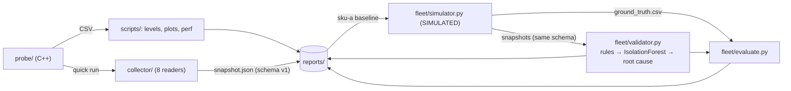
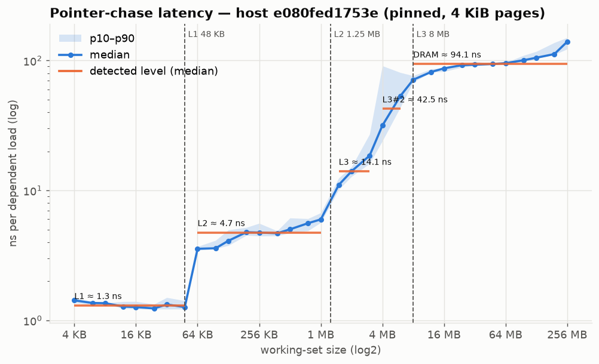
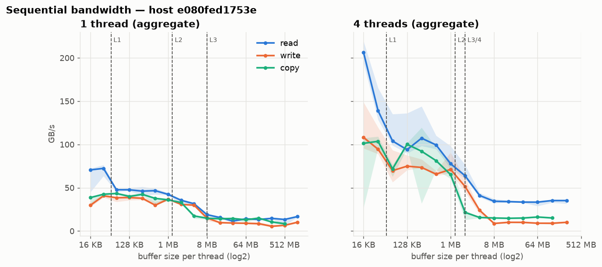
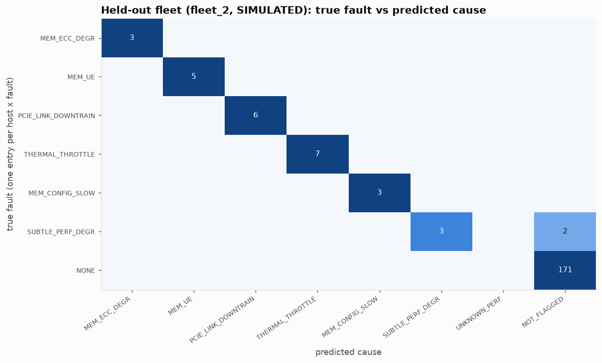

# SiliconScope

[](https://github.com/ForcedScripter/siliconscope/actions/workflows/ci.yml)

**A small-scale silicon validation and fleet-health toolkit.** C++ microbenchmarks measure a
machine's real memory hierarchy (L1/L2/L3/DRAM latency, bandwidth) and explain every step of
the curve with perf-counter evidence. A Python collector reads Linux hardware-health
interfaces (caches, memory, thermals, PCIe link state, ECC counters) into one versioned JSON
snapshot that never crashes on missing hardware. A fleet validator then triages ~200
**SIMULATED** servers in that same schema: deterministic rules + a per-SKU Isolation Forest
flag the bad hosts, name the root cause from 6 silicon fault types, recommend an action, and
are scored on a held-out fleet. In short, it's a laptop-sized version of a release-to-production
team's bring-up → fleet tooling.



More detail: [docs/architecture.md](docs/architecture.md).

## Quickstart

```bash
pip install -r requirements.txt   # Python 3.11+; also needs g++ and make
make all        # probe → collect → fleet → evaluate → report   (~3 min)
make test lint  # 47 tests, no real hardware needed (fake sysfs trees)
make perf       # optional: TLB experiment with perf counters (explains itself if perf is blocked)
```

| Target | What it does | Outputs |
|---|---|---|
| `make probe` | builds the probes; latency (random, huge pages, sequential); bandwidth (1 and 4 threads) | `reports/latency_*.{csv,png}`, `latency_levels.json`, `bandwidth_*` |
| `make collect` | health snapshot of this machine + quick probe | `reports/snapshot_<host>.json` |
| `make fleet` | simulate seeds 1–11, tune on seed 1, triage held-out seed 2 | `data/`, `reports/fleet_*`, `thresholds.json` |
| `make evaluate` | score held-out seed 2 (+ seeds 3–11), ablation | `reports/evaluation.md`, `confusion_matrix.png` |
| `make report` | health report for this real machine | `reports/health_<host>.md` |

> Re-running `make probe` re-measures, so your numbers will differ from the committed ones below.

## Real results (measured on the dev machine)

Intel i5-1135G7 (Tiger Lake, 4C/8T) under **WSL2 / Hyper-V**. Host id `e080fed1753e` (a hash; the
raw hostname is never stored).

### Memory latency and detected cache levels



Change-point detection on the curve ([`reports/latency_levels.json`](reports/latency_levels.json)).
It finds every reported cache size within ≤ 0.21 octaves:

| Detected level | Working set | Latency (median) | sysfs size |
|---|---|---:|---|
| L1 | 4 KB – 48 KB | **1.30 ns** | 48 KB |
| L2 | 64 KB – 1 MB | **4.74 ns** | 1.25 MB |
| L3 | 1.5 MB – 3 MB | **14.05 ns** | 8 MB (shared) |
| L3 (partly missing) | 4 MB – 6 MB | 42.48 ns | |
| DRAM | 8 MB – 256 MB | **94.05 ns** | |

What the experiments showed ([details in LEARNING.md §3, §6, §7](docs/LEARNING.md#3-reading-our-latency-curve-step-by-step)):

- **Prefetcher.** Sequential pointer-chasing at 256 MB is **5.97 ns** vs **139.48 ns** random (23×).
- **The early jump below the 8 MB L3 is *not* the TLB.** perf counts ≈ 0 page walks per hop at
  4–6 MB (0.003–0.035), while LLC misses per hop rise from 0.039 to 1.05. Huge pages don't remove
  it. The core simply gets less than 8 MB of a shared L3.
- **Above ~8 MB, the TLB does matter.** Page walks reach 0.89 per hop at 64 MB. Under Hyper-V,
  guest huge pages (verified: `AnonHugePages` = 65536 kB) did **not** reduce walks (0.891 vs
  0.890), but made each one cheaper (64 MB: 119.5 → 97.1 ns; 256 MB sweep: 139.5 → 101.2 ns).
  That's consistent with the host backing guest memory with 4 KiB pages.

### Bandwidth ([`reports/bandwidth_summary.json`](reports/bandwidth_summary.json))



| | read | write | copy |
|---|---:|---:|---:|
| 1 thread, in-cache peak | 72.34 GB/s | 40.62 | 43.40 |
| 1 thread, DRAM | 13.73 GB/s | 8.75 | 12.97 |
| 4 threads (1 per core), in-cache peak | 206.16 GB/s | 108.08 | 103.59 |
| 4 threads, DRAM | 34.27 GB/s | 9.49 | 15.12 |

### Health snapshot of this machine

[`reports/snapshot_e080fed1753e.json`](reports/snapshot_e080fed1753e.json) validates against
schema v1. Platform, CPU, caches, memory, storage and the quick probe are available
(L1 1.30 / L2 3.68 / L3 15.05 / DRAM 94.79 ns, read 15.98 GB/s). **Thermal, PCIe and ECC are
unavailable in WSL2**, each with its reason, and the single-host report marks them
"not evaluated" rather than "pass" ([`reports/health_e080fed1753e.md`](reports/health_e080fed1753e.md)).

## Fleet results (SIMULATED)

200 simulated servers per test fleet, 3 SKUs, 12 % faulty, 6 fault types. Thresholds were tuned
on seed 1 only; **seed 2 is held out** ([`reports/evaluation.md`](reports/evaluation.md)).

| Held-out seed 2 | Precision | Recall | F1 |
|---|---:|---:|---:|
| rules only | 1.000 | 0.862 | 0.926 |
| Isolation Forest only | 1.000 | 0.448 | 0.619 |
| **combined** | **1.000** | **0.931** | **0.964** |

Root cause named exactly right on **27/27** true positives (1.0). Across nine more held-out
seeds (3–11), combined F1 = **0.963 ± 0.022**.

**Ablation: which stage catches what** (pooled detection recall, seeds 3–11):

| Fault type | rules only | ML only | combined |
|---|---:|---:|---:|
| MEMORY_UE | 1.000 | 0.059 | 1.000 |
| MEMORY_ECC_DEGRADATION | 1.000 | 0.061 | 1.000 |
| PCIE_LINK_DOWNTRAIN | 1.000 | 0.026 | 1.000 |
| THERMAL_THROTTLING | 1.000 | 1.000 | 1.000 |
| MEMORY_CONFIG_SLOW | 1.000 | 0.978 | 1.000 |
| SUBTLE_PERF_DEGRADATION | 0.333 | **0.833** | 0.854 |

The rules catch faults that have no perf signature. The ML stage catches the 5–8 %
multi-metric slowdown that no single-metric threshold can.



Triage report with evidence and actions, worst first: [`reports/fleet_report.md`](reports/fleet_report.md).
Plots: [latency vs bandwidth by verdict](reports/fleet_scatter.png),
[CE trends of flagged hosts](reports/fleet_ce_trends.png).

## What's real vs simulated

| Real (measured in this repo) | SIMULATED |
|---|---|
| Latency curve, cache levels, prefetcher and huge-page experiments | All 200-host fleets and every fleet number |
| perf counter TLB/LLC evidence (`reports/perf_tlb.md`) | Fault injection (6 types) and ground truth |
| Bandwidth (1 and 4 threads) | sku-b / sku-c baselines (derived from sku-a by documented ratios) |
| Health snapshot of the dev machine, incl. what is *unavailable* | CPU frequency and temperatures of every SKU (not measurable in WSL2; documented assumptions) |
| sku-a perf baseline (copied from the real measurements) | ECC history, PCIe links, thermal readings of fleet hosts |

## Limitations

- **One real machine, and it's a VM.** WSL2 exposes no thermal sensors, cpufreq, EDAC or real
  PCIe devices, so those readers are only exercised on fake sysfs trees and simulated data.
- **Laptop VM noise.** The host shares physical cores and changes power states. One full
  bandwidth run was 3–4× low in-cache and is kept in [`reports/glitch/`](reports/glitch/).
  Pinning a vCPU doesn't pin a physical core.
- **perf counts the whole process**, including the probe's setup, so the counters are
  compared *between* configurations rather than read as absolutes.
- **The fleet is simulated.** Fault signatures are modelled on how these failures present, but
  real faults are messier: intermittent, correlated by rack or batch, and drifting with workload.
- **Per-type numbers on one 200-host fleet rest on 3–7 hosts each**, hence the extra seeds.

## How this would scale to a real fleet

- **Agent per host.** The collector runs as a daemon or cron job and ships snapshots to a central
  store (time-series DB / object store), keyed by `host_id` and SKU. The schema version allows
  rolling upgrades.
- **History, not snapshots.** CE trends come from the store (14-day windows), not one reading.
  Probes run during maintenance windows or idle time, not on busy production hosts.
- **Per-SKU baselines** come from known-good hosts (burn-in results), refreshed per
  firmware/BIOS release. Golden-config diffs explain SUBTLE regressions.
- **Burn-in and stress before production:** stress-ng (CPU/thermal), memtester / memtest86
  (DIMMs), fio (storage), plus these probes as a performance gate.
- **Closed loop.** Validator verdicts open tickets with evidence and the recommended action;
  repair outcomes become labels to retune thresholds and measure precision and recall on real
  data.

## Repository guide

- [docs/WALKTHROUGH.md](docs/WALKTHROUGH.md): the codebase in reading order.
- [docs/LEARNING.md](docs/LEARNING.md): every concept used, linked to code.
- [docs/INTERVIEW.md](docs/INTERVIEW.md): Q&A, pitch, resume bullets.
- [docs/DECISIONS.md](docs/DECISIONS.md): every judgment call, with the alternatives considered.
- [CLAUDE.md](CLAUDE.md): the original project spec.
