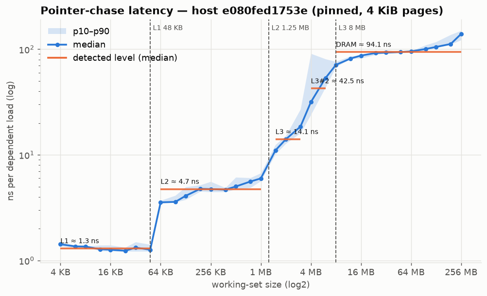
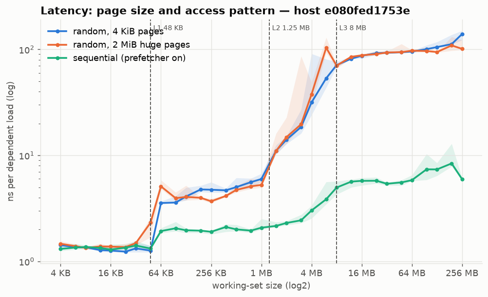
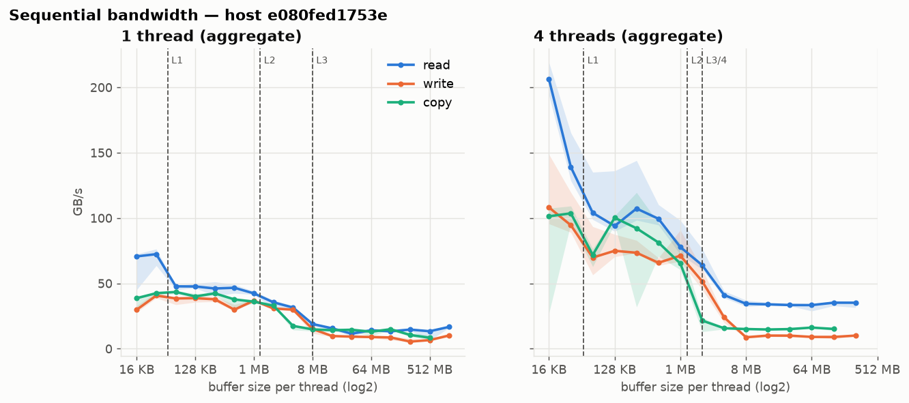

# Learning notes

Beginner-friendly explanations of every concept SiliconScope uses, each linked
to the code where it appears. Numbers quoted here come from the real runs in
[`reports/`](../reports/) on the development machine (Intel i5-1135G7 "Tiger
Lake", 4 cores / 8 threads, running Ubuntu under **WSL2 / Hyper-V**). Simulated
numbers are always labelled SIMULATED.

**Contents**

1. [Caches and the memory hierarchy](#1-caches-and-the-memory-hierarchy)
2. [Pointer chasing and Sattolo's algorithm](#2-pointer-chasing-and-sattolos-algorithm)
3. [Reading our latency curve, step by step](#3-reading-our-latency-curve-step-by-step)
4. [Automatic level detection (change points)](#4-automatic-level-detection-change-points)
5. [sysfs and procfs](#5-sysfs-and-procfs)
6. [Hardware prefetching](#6-hardware-prefetching)
7. [TLB and huge pages](#7-tlb-and-huge-pages)
8. [perf and hardware performance counters](#8-perf-and-hardware-performance-counters)
9. [Memory bandwidth](#9-memory-bandwidth)

<!-- PHASE2+ sections are appended below as they are built. -->

---

## 1. Caches and the memory hierarchy

A CPU core can execute several instructions per nanosecond, but DRAM takes
roughly 100 ns to answer a load. Caches are small, fast SRAM memories that keep
recently used data close to the core:

| Level | Typical size (this CPU, from sysfs) | Who shares it | Rough latency |
|---|---|---|---|
| L1 data | 48 KB | one core (and its 2 hyperthreads) | 4–5 cycles |
| L2 | 1.25 MB | one core | ~14 cycles |
| L3 (LLC) | 8 MB | all cores | 40–70 cycles |
| DRAM | GBs | whole machine | 100+ ns |

Data moves between levels in fixed **cache lines** of 64 bytes
(`coherency_line_size` in sysfs). Loading one byte brings in its whole line.

**Why measure it?** A silicon validation team checks that a new chip (or a
server in the fleet) actually delivers the latency and bandwidth its design
promises. A DIMM at the wrong speed, a mis-set BIOS option or a faulty part
shows up as a shifted curve.

Where: [`probe/latency.cpp`](../probe/latency.cpp), [`collector/readers/cache.py`](../collector/readers/cache.py).

## 2. Pointer chasing and Sattolo's algorithm

To measure *latency* (not throughput) we need loads that cannot overlap. Modern
cores run dozens of independent loads in parallel ("memory-level parallelism"),
which hides latency. Pointer chasing makes every load depend on the previous
one:

```cpp
for (i = 0; i < steps; ++i) p = p->next;   // the address of load i+1 IS the data of load i
```

The core can't start the next load until the current one returns, so
`elapsed / steps` = latency of one load.

Three design details in [`probe/latency.cpp`](../probe/latency.cpp):

- **One node per 64-byte line.** `struct alignas(64) Node`. Every hop touches a
  new line; otherwise neighbouring hops would hit a line we already loaded.
- **Random order defeats the prefetcher.** Hardware prefetchers detect
  sequential and strided access and fetch ahead. A random order gives them
  nothing to predict. ([§6](#6-hardware-prefetching) shows what happens with a
  sequential order.)
- **Sattolo's algorithm, not plain shuffle.** Fisher–Yates shuffle picks swap
  partner `j` from `[0, i]`; Sattolo picks from `[0, i)`. That tiny change
  guarantees the permutation is **one single cycle** through all `n` nodes.
  A plain random permutation usually breaks into several cycles; if we started
  in a short one, we'd loop over a few nodes that sit in L1 and badly
  under-report latency.

Other measurement hygiene:

- **Warm-up lap** before timing, so we measure steady state, not page faults.
- **Pinning** with `sched_setaffinity` ([`probe/common.hpp`](../probe/common.hpp))
  so the OS doesn't migrate us to a core with a cold cache mid-run.
- **Repeats + percentiles.** 5 timed runs per size; we report median, p10, p90.
- **Dead-code elimination.** If the result `p` were never used, `-O2` could
  delete the whole loop. We add it into a `volatile` global (`g_sink`).
- **Enough steps.** At least 2²¹ hops per sample, so a sample lasts
  milliseconds and the ~20 ns cost of reading the clock is irrelevant.

## 3. Reading our latency curve, step by step



Canonical run (`make probe`: 4 KB → 256 MB, 5 repeats, pinned to CPU 0), as
detected in [`reports/latency_levels.json`](../reports/latency_levels.json):

| Detected plateau | Sizes | Median latency | What serves the loads |
|---|---|---|---|
| L1 | 4 KB – 48 KB | 1.30 ns | L1d hit |
| L2 | 64 KB – 1 MB | 4.74 ns | L2 hit (+ STLB lookups past 256 KB) |
| L3 | 1.5 MB – 3 MB | 14.05 ns | L3 hit |
| L3#2 | 4 MB – 6 MB | 42.48 ns | mix of L3 hits and DRAM: *effective* L3 is smaller than 8 MB |
| DRAM | 8 MB – 256 MB | 94.05 ns | DRAM (+ page walks beyond ~8 MB) |

All three reported cache sizes have a detected knee within half an octave
(L1 0.21, L2 0.03, L3 0.21 octaves; `knee_match` in the JSON).

Every step, with the evidence for it (the perf numbers come from
[`reports/perf_tlb.md`](../reports/perf_tlb.md), see [§7](#7-tlb-and-huge-pages)):

1. **≤ 48 KB → 1.3 ns (L1).** The whole cycle fits in the 48 KB L1d, so every
   hop is an L1 hit: ~5 cycles at ~4 GHz turbo.
2. **48 → 64 KB: ×2.8 jump (L1 → L2).** The set no longer fits L1. With random
   order, nearly every hop misses L1 and is served by L2. The knee sits exactly
   on the sysfs line because L1 and L2 are **private** to the core, so nothing
   else competes for them.
3. **Gentle rise inside L2, 256 KB → 1 MB (≈3.6 → 6 ns): the first-level TLB.**
   The L1 dTLB holds 64 entries × 4 KiB = 256 KB of "reach". Past 256 KB,
   hops start missing it and pay a few cycles for a second-level TLB (STLB)
   lookup. Evidence: with 2 MiB huge pages the same sizes are faster
   (256 KB: 4.74 → 3.69 ns; 1 MB: 5.99 → 5.27 ns), and perf shows ~0 page
   walks there (an STLB *hit* is not a walk).
4. **1 → 1.5 MB: ×1.8 jump (L2 → L3)**, right on the 1.25 MB L2 line.
5. **The early jump: 3 MB → 6 MB climbs 18 → 53 ns, below the 8 MB L3.**
   *Hypothesis A: TLB misses.* **Rejected**:
   - perf counts only 0.003 page walks per hop at 4 MB and 0.035 at 6 MB;
   - huge pages leave the curve unchanged there (4 MB: 31.6 vs 37.6 ns;
     6 MB: 53.4 vs 103.6 ns, where the huge-page point is a noisy outlier).

   *Hypothesis B: the core gets less than 8 MB of L3.* **Supported**: perf
   LLC misses per hop rise from 0.039 at 2 MB to 0.26 at 4 MB and ≥ 1 at
   6 MB. So by 6 MB, essentially every hop misses L3. Reasons the effective
   capacity is lower than nominal:
   - the L3 is **shared** by all 4 cores, the integrated GPU and, under
     Hyper-V, the whole Windows host, whose working sets occupy part of it;
   - Tiger Lake's L3 is **non-inclusive** and uses an adaptive, not pure-LRU,
     replacement policy;
   - with 4 KiB pages, the physical addresses are effectively random, so some
     cache sets fill up before others (**conflict misses**).
6. **8 MB → 16 MB+: DRAM (~87–95 ns).**
7. **16 MB → 256 MB: DRAM latency keeps rising (87 → 139 ns): page walks.**
   The STLB covers about 2048 × 4 KiB = 8 MB. perf: 0.55 walks/hop at 16 MB
   and 0.89 at 64 MB. In a VM each walk is a **2-D nested walk** (the guest
   page tables are themselves translated by the hypervisor's EPT tables), so
   a miss costs dozens of extra loads.

   Huge pages make each walk *cheaper* (256 MB: 139.5 → 101.2 ns; 64 MB under
   perf: 119.5 → 97.1 ns) but *not rarer*: the walks per hop are identical
   (0.89 vs 0.89). The likely reason: the guest really got 2 MiB pages
   (`AnonHugePages` = 65536 kB for the 64 MB run), but the host backs guest
   memory with 4 KiB pages. A TLB entry caches the combined guest→host
   translation at the **smaller** of the two page sizes, so TLB reach doesn't
   grow; only the guest half of the walk gets one level shorter.

**About the "~16 MB jump below L3" in the spec.** On this machine the big
early jump is at 3–6 MB (an L3 capacity effect), and the TLB effect starts
around 8–16 MB, where it is part of the DRAM region. Run-to-run note: the first
exploratory sweep (Phase 1) put L2 at 3.79 ns and showed a separate 6–16 MB
plateau. The canonical run above differs by up to ~25 % in the L2/L3 region:
a laptop VM is noisy, which is why we report p10/p90 bands and detect levels
on p10.

## 4. Automatic level detection (change points)

[`scripts/plot_latency.py`](../scripts/plot_latency.py) turns the curve into
levels without being told the cache sizes:

1. Take log(p10 latency) per size. **Log** because each level is a
   multiplicative jump (×3, ×3, ×10). **p10** because noise on a VM (other
   tenants, the Windows host) only ever *adds* time, so low percentiles are
   closer to the true cost.
2. Fit the best **piecewise-constant** ("staircase") function with *k* steps by
   dynamic programming: `dp[s][j]` = least squared error covering the first `j`
   points with `s` steps. O(k·n²) for n ≈ 33 points is instant.
3. Add steps while each new step removes ≥ 35 % of the remaining error
   (`MIN_GAIN`); stop when an extra step would only be fitting noise.
4. Boundaries between steps are the **knees**. Each plateau is then *named*
   L1/L2/L3/DRAM by checking which sysfs-reported cache holds its first size.
5. `match_knees` checks every reported cache size has a knee within half an
   octave (×1.41, our grid resolution). Canonical run: L1 ✅ (0.21
   octaves), L2 ✅ (0.03), L3 ✅ (0.21: the knee between 6 MB and 8 MB). In the
   first exploratory sweep the L3 knee was 0.71 octaves away. Capacity edges
   of a shared L3 are soft, and they move between runs.

Why not "ratio between neighbours > threshold" (the simple approach)? On this
machine the L3 region rises smoothly from 11 to 80 ns, so a neighbour-ratio
rule fires at almost every point there. Fitting the whole staircase at once is
more robust. Decision logged in [`DECISIONS.md`](DECISIONS.md).

## 5. sysfs and procfs

Linux exposes kernel and hardware state as files:

- **procfs** (`/proc`): process and kernel info. `/proc/meminfo`'s
  `MemAvailable` is the kernel's estimate of memory we can use without
  swapping. The probe reads it before allocating
  ([`probe/common.hpp`](../probe/common.hpp) `cap_to_available`).
- **sysfs** (`/sys`): the kernel's device model. Each cache of cpu0 is a
  directory `/sys/devices/system/cpu/cpu0/cache/indexN/` with files `level`,
  `type`, `size`, `coherency_line_size`, `ways_of_associativity`,
  `shared_cpu_list` ([`collector/readers/cache.py`](../collector/readers/cache.py)).

Because they're just files, we can **fake** them in tests: copy the directory
shape into `tests/fixtures/fake_sysfs/…` and point the reader's `root` there.

## 6. Hardware prefetching

A prefetcher watches the stream of cache misses and, when it spots a pattern
(next line, constant stride, ascending stream within a page), fetches lines
*before* the core asks for them. Intel cores have several: L1 next-line and
IP-stride prefetchers, and L2 "streamer" and adjacent-line prefetchers.

Experiment: `latency --pattern sequential` links node *i* → *i+1*. Every load
still depends on the previous one, but the addresses are predictable:

| Size | random | sequential | speed-up |
|---|---:|---:|---:|
| 256 KB (L2) | 4.74 ns | 1.90 ns | 2.5× |
| 4 MB (L3) | 31.59 ns | 3.02 ns | 10× |
| 64 MB (DRAM) | 95.49 ns | 5.84 ns | 16× |
| 256 MB (DRAM) | 139.48 ns | 5.97 ns | 23× |

(Medians from `comparison_ns_median` in `reports/latency_levels.json`; plot:
[`reports/latency_compare_e080fed1753e.png`](../reports/latency_compare_e080fed1753e.png).)



So **the same data at the same size is 23× faster when the hardware can guess
the next address.** That's why the latency probe must randomise. It is also
why real software lays data out contiguously (arrays rather than linked lists).
The adjacent-line prefetcher also shows up in perf: at DRAM sizes we see ~1.9
LLC misses per hop. Each demand miss also pulls in its 128-byte "buddy" line.

Where: `sequential_cycle()` in [`probe/latency.cpp`](../probe/latency.cpp).

## 7. TLB and huge pages

Programs use **virtual** addresses; the CPU translates each one to a physical
address through a 4-level **page table** in memory. Walking the tables on every
load would be far too slow, so recent translations are cached in the **TLB**
(Translation Lookaside Buffer):

- L1 dTLB: ~64 entries. With 4 KiB pages that's a reach of 256 KB.
- STLB (second level): ~2048 entries, a reach of ~8 MB.
- Miss in both → a **page walk** (several dependent memory loads).

**Huge pages** (2 MiB on x86-64) let one TLB entry cover 512× more memory.
Linux's *transparent* huge pages (THP) can provide them automatically.
`madvise(MADV_HUGEPAGE)` asks for them on a specific region. Our system has
THP in `madvise` mode (`/sys/kernel/mm/transparent_hugepage/enabled`).
`latency --hugepages` uses that call, and then **checks it worked** by reading
`AnonHugePages` from `/proc/self/smaps_rollup`. You must verify, because
madvise is only a hint. For a 64 MB run it reported 65536 kB: fully backed.

**In a VM there are two page tables.** The guest OS maps guest-virtual →
guest-physical; the hypervisor maps guest-physical → host-physical (Intel
EPT). A TLB miss triggers a *2-D walk*: up to 24 memory references instead of
4. And the TLB entry can only be as large as the *smaller* of the guest page
and the host page backing it.

Our evidence ([`reports/perf_tlb.md`](../reports/perf_tlb.md), `make perf`):

| size | page | ns/hop | page walks/hop | LLC misses/hop |
|---:|---|---:|---:|---:|
| 4 MB | 4 KiB | 29.14 | 0.003 | 0.262 |
| 4 MB | 2 MiB | 24.04 | 0.010 | 0.352 |
| 6 MB | 4 KiB | 60.13 | 0.035 | 1.051 |
| 6 MB | 2 MiB | 48.12 | 0.025 | 0.805 |
| 16 MB | 4 KiB | 90.51 | 0.552 | 1.753 |
| 16 MB | 2 MiB | 91.72 | 0.559 | 1.725 |
| 64 MB | 4 KiB | 119.52 | 0.891 | 1.949 |
| 64 MB | 2 MiB | 97.13 | 0.890 | 1.897 |

What it shows:

- **Below 8 MB, page walks are near zero**, so the TLB cannot explain the
  3–6 MB latency jump. LLC misses can (see §3, step 5).
- **Above 8 MB, walks appear** (0.55 → 0.89 per hop), matching an STLB reach
  of about 8 MB.
- **Huge pages did not reduce walks** in this VM, even with the guest fully
  THP-backed. They did make walks cheaper (64 MB: 119.5 → 97.1 ns). On bare
  metal, or with a host that backs the VM with large pages, we'd expect walks
  to drop to near zero, too.

## 8. perf and hardware performance counters

CPUs contain a **PMU** (performance monitoring unit): a handful of
programmable counters that count hardware events such as cycles, retired
instructions, cache misses or page walks. `perf stat -e <events> -- cmd` runs
a command and reports the totals.

[`scripts/run_perf.sh`](../scripts/run_perf.sh) wraps it and degrades
gracefully:

- **No matching perf binary.** Ubuntu's `/usr/bin/perf` refuses to run unless
  a `linux-tools` package matches `uname -r`, which is never true on WSL. The
  script then tries any installed versioned binary.
- **`perf_event_paranoid` > 2 and not root.** It explains this and exits 0.
- **`<not supported>` events.** Many VMs don't expose a PMU. The script keeps
  the output and warns.

On this WSL2 machine (kernel 6.6, paranoid = 2) user-space counters **work**.
Event names are generic aliases: on Intel `dTLB-load-misses` means "dTLB miss
that caused a page walk", and `cache-misses` means LLC misses. Counting is per
process and includes setup work, so [`scripts/perf_tlb.py`](../scripts/perf_tlb.py)
divides by the known number of hops and compares *between* configurations, not
absolute values.

## 9. Memory bandwidth

[`probe/bandwidth.cpp`](../probe/bandwidth.cpp) streams through a buffer in
order. Unlike the latency probe, its loads are **independent**, so the core
keeps many in flight and measures throughput:

- **read**: sum 8-byte words, using **8 independent accumulators**. With a
  single `sum +=`, each add waits for the previous one and the loop measures
  adder latency. Our first version reached only ~16 GB/s in L1 that way.
- **write**: store to every word.
- **copy**: `dst[i] = src[i]`, counted as 2× size of traffic (STREAM convention).

Canonical results ([`reports/bandwidth_summary.json`](../reports/bandwidth_summary.json)):



| | read | write | copy |
|---|---:|---:|---:|
| 1 thread, peak (in cache) | 72.34 GB/s | 40.62 | 43.40 |
| 1 thread, DRAM (≥ 32 MB) | 13.73 GB/s | 8.75 | 12.97 |
| 4 threads, peak (aggregate) | 206.16 GB/s | 108.08 | 103.59 |
| 4 threads, DRAM (aggregate) | 34.27 GB/s | 9.49 | 15.12 |

Why these shapes:

- **One core can't saturate DRAM** (13.7 vs 34.3 GB/s with 4 cores).
  *Little's law*: bandwidth = bytes in flight ÷ latency. A core tracks only
  ~12–16 outstanding L1 misses (fill buffers). 16 × 64 B ÷ ~90 ns ≈ 11 GB/s,
  and L2 prefetchers add a bit more. More cores = more misses in flight.
- **Writes to DRAM are slower than reads** (8.75 vs 13.73 GB/s).
  *Write-allocate*: before storing to a line that isn't cached, the core must
  first **read** it (a "read for ownership"). So every written byte costs a
  read plus a later write-back.
- **SMT siblings share a core.** sysfs says L1/L2 are shared by
  `cpu0-1`, so vCPUs 0 and 1 are hyperthreads of one physical core. Pinning 4
  threads to CPUs 0–3 put them on only 2 cores. The probe now picks one CPU per
  physical core first (`cpus_one_per_core_first()` in `common.hpp`; CPUs
  0, 2, 4, 6), which raised the 4-thread in-cache read peak to 206 GB/s,
  about 3× the single-thread peak.
- **A real measurement glitch.** One full `make probe` run measured
  single-thread read at ~15–22 GB/s for 32 KB–1 MB buffers. Minutes later,
  the same binary measured 48–76 GB/s at those sizes. The degraded run is kept
  in [`reports/glitch/`](../reports/glitch/) as evidence. Cause: on a laptop VM
  the Windows host shares the physical cores and changes power states, and
  pinning a *vCPU* doesn't pin a physical core. That is exactly why the fleet
  validator (Phase 4) must be robust to single-measurement glitches.
