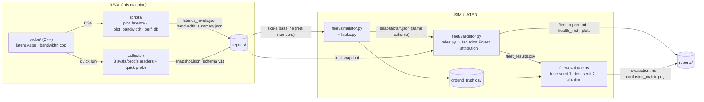

# Architecture

## Data flow in one paragraph

The C++ **probes** measure this machine's memory hierarchy. The **plot scripts** turn the
CSVs into detected cache levels and bandwidth summaries in `reports/`. The **collector** reads
Linux health interfaces (plus a quick probe) into one schema-v1 **snapshot**. The **simulator**
seeds `sku-a` from the real `reports/` numbers and writes hundreds of SIMULATED snapshots in
the *same* schema, with ground truth kept in a separate file. The **validator** reads only
snapshots: deterministic rules first, then a per-SKU Isolation Forest, then root-cause
attribution with severity and action. **evaluate** is the only component that reads ground
truth. It tunes on seed 1 and scores held-out seed 2 (plus seeds 3–11).

## Why the schema is the contract

`collector/schema.py` is imported by both sides. The collector validates before writing; the
simulator calls `assert_valid` on every host; tests check both. The validator can therefore run
unchanged on a real machine (`make report`) or a simulated fleet (`make fleet`). In a real
deployment the simulator would simply be replaced by per-host agents.
