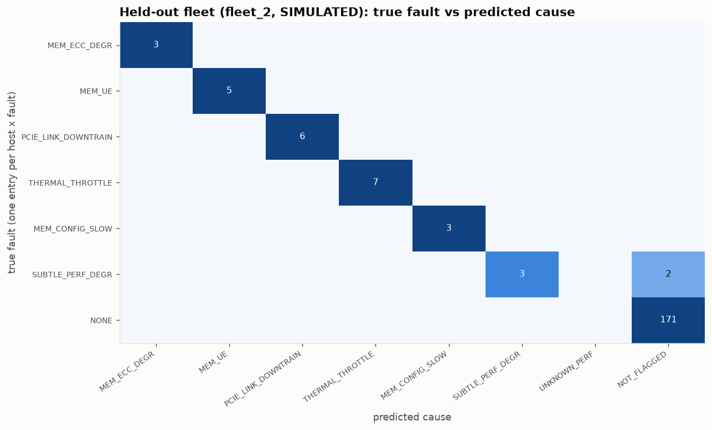

# Evaluation (SIMULATED fleet)

> Every number below comes from SIMULATED fleets generated by `fleet/simulator.py`. Nothing here is a measurement of real servers.

## Protocol

- **Tuning fleet:** `data/fleet_1` (seed 1). Thresholds were grid-searched **only** here (`python -m fleet.evaluate --tune`) and frozen in `reports/thresholds.json`.
- **Held-out test fleet:** `data/fleet_2` (seed 2). Headline numbers. Not used for any design or tuning decision.
- **Robustness:** 9 more held-out fleets (seeds 3–11) show how much the headline moves with the random draw.
- Development used separate dev seeds (101+), never reported.
- The validator reads only `snapshots/`; only this script reads `ground_truth.csv`.

Frozen thresholds: `ce_slope_per_day=0.5`, `ce_total=10`, `temp_c=86.0`, `freq_ratio=0.9`, `z_abs=4.0`, `if_score=0.59`
(tuning F1 on seed 1: CE rule 0.98, thermal rule 1.0, combined detection 0.996)

## Held-out results (fleet_2: 200 hosts, 29 faulty)

### Detection (is the host faulty?)

| Stages | Precision | Recall | F1 | TP | FP | FN |
|---|---:|---:|---:|---:|---:|---:|
| rules | 1.000 | 0.862 | 0.926 | 25 | 0 | 4 |
| ml | 1.000 | 0.448 | 0.619 | 13 | 0 | 16 |
| combined | 1.000 | 0.931 | 0.964 | 27 | 0 | 2 |

### Root cause (combined system)

- True-positive hosts: 27
- Exact cause-set accuracy: **1.0**
- Primary cause correct: **1.0**

### Per fault type

| Fault type | Hosts | Detect recall: rules | ML | combined | Cause precision | Cause recall |
|---|---:|---:|---:|---:|---:|---:|
| MEMORY_ECC_DEGRADATION | 3 | 1.0 | 0.0 | 1.0 | 1.0 | 1.0 |
| MEMORY_UE | 5 | 1.0 | 0.0 | 1.0 | 1.0 | 1.0 |
| PCIE_LINK_DOWNTRAIN | 6 | 1.0 | 0.0 | 1.0 | 1.0 | 1.0 |
| THERMAL_THROTTLING | 7 | 1.0 | 1.0 | 1.0 | 1.0 | 1.0 |
| MEMORY_CONFIG_SLOW | 3 | 1.0 | 1.0 | 1.0 | 1.0 | 1.0 |
| SUBTLE_PERF_DEGRADATION | 5 | 0.2 | 0.6 | 0.6 | 1.0 | 0.6 |

### Confusion matrix (combined)

Rows: true fault (multi-fault hosts contribute one entry per fault; healthy hosts are `NONE`). Columns: the predicted cause matching that fault if present, else the host's primary predicted cause, else `NOT_FLAGGED`.

| true \ predicted | MEMORY_ECC_DEGRADATION | MEMORY_UE | PCIE_LINK_DOWNTRAIN | THERMAL_THROTTLING | MEMORY_CONFIG_SLOW | SUBTLE_PERF_DEGRADATION | UNKNOWN_PERF_ANOMALY | NOT_FLAGGED |
|---|---:|---:|---:|---:|---:|---:|---:|---:|
| MEMORY_ECC_DEGRADATION | 3 | 0 | 0 | 0 | 0 | 0 | 0 | 0 |
| MEMORY_UE | 0 | 5 | 0 | 0 | 0 | 0 | 0 | 0 |
| PCIE_LINK_DOWNTRAIN | 0 | 0 | 6 | 0 | 0 | 0 | 0 | 0 |
| THERMAL_THROTTLING | 0 | 0 | 0 | 7 | 0 | 0 | 0 | 0 |
| MEMORY_CONFIG_SLOW | 0 | 0 | 0 | 0 | 3 | 0 | 0 | 0 |
| SUBTLE_PERF_DEGRADATION | 0 | 0 | 0 | 0 | 0 | 3 | 0 | 2 |
| NONE | 0 | 0 | 0 | 0 | 0 | 0 | 0 | 171 |

## Robustness across 9 more held-out seeds

| Stages | Precision (mean ± sd) | Recall | F1 |
|---|---|---|---|
| rules | 0.988 ± 0.023 | 0.849 ± 0.090 | 0.910 ± 0.052 |
| ml | 0.945 ± 0.051 | 0.515 ± 0.033 | 0.665 ± 0.033 |
| combined | 0.960 ± 0.040 | 0.968 ± 0.035 | 0.963 ± 0.022 |

Pooled per-type detection recall over these seeds (combined | rules | ML):

| Fault type | Hosts | combined | rules only | ML only |
|---|---:|---:|---:|---:|
| MEMORY_ECC_DEGRADATION | 33 | 1.000 | 1.000 | 0.061 |
| MEMORY_UE | 34 | 1.000 | 1.000 | 0.059 |
| PCIE_LINK_DOWNTRAIN | 39 | 1.000 | 1.000 | 0.026 |
| THERMAL_THROTTLING | 36 | 1.000 | 1.000 | 1.000 |
| MEMORY_CONFIG_SLOW | 45 | 1.000 | 1.000 | 0.978 |
| SUBTLE_PERF_DEGRADATION | 48 | 0.854 | 0.333 | 0.833 |

Exact root-cause accuracy on TPs (combined): 0.988 ± 0.026

